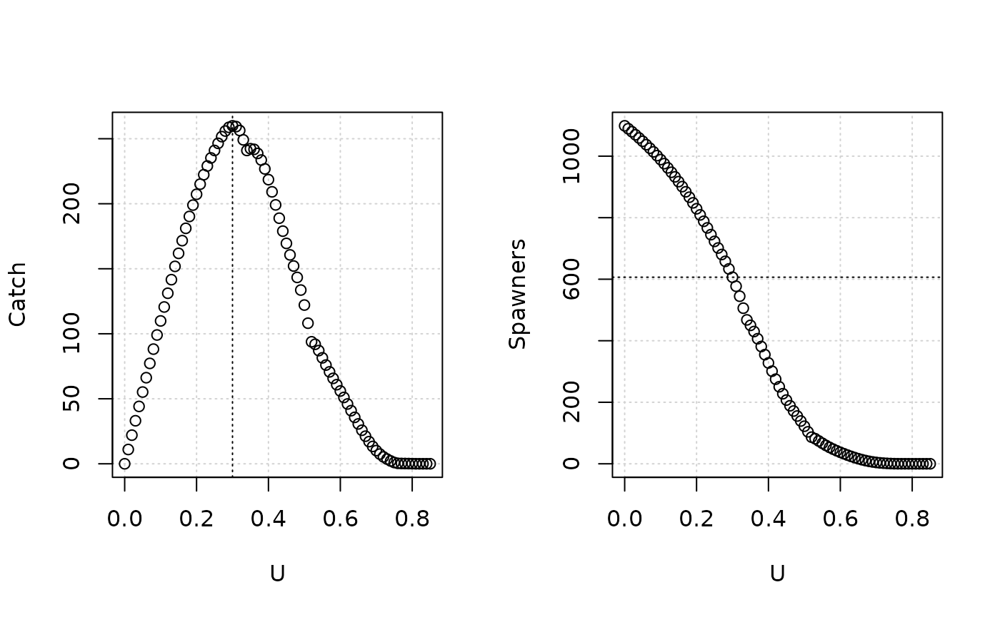
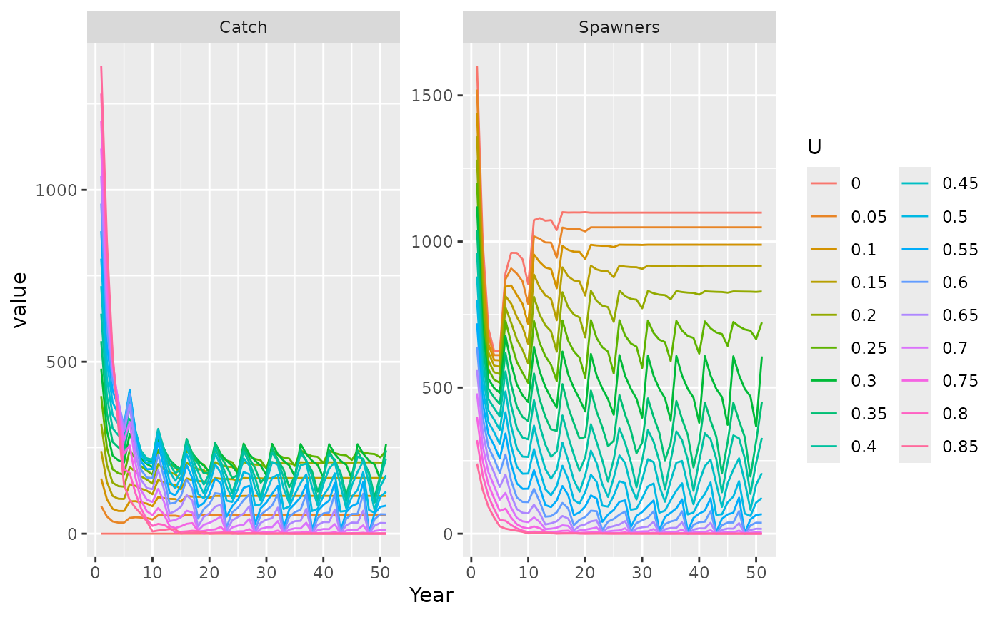
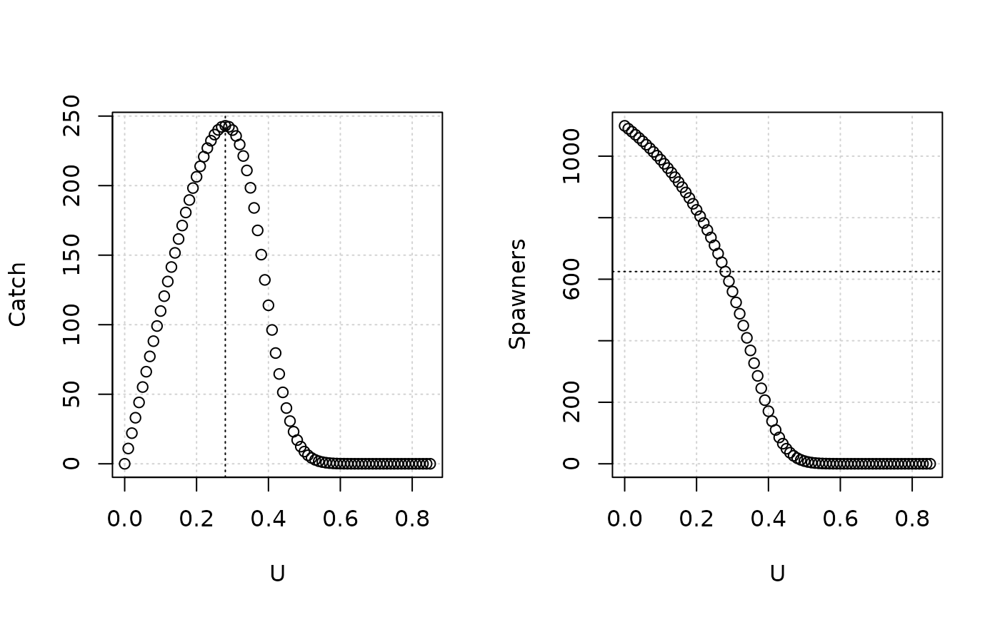
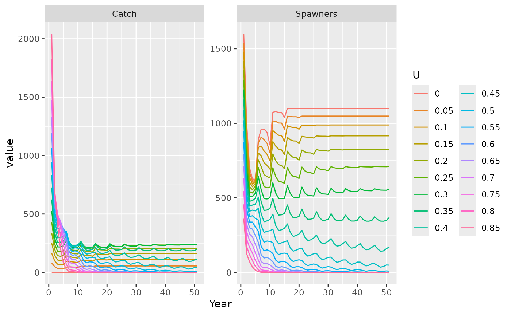

# Reference points

## Introduction

Reference points for salmon typically use the Ricker stock function that
predict the return as a density-dependent relationship with the number
of spawners, typically of the previous generation for salmon with single
brood year returns.

The Ricker function is

\\ R = a\times S\exp(-bS) \\

where \\R\\ is the return and \\S\\ is the spawners. Parameters \\a\\ is
in units of returns/spawner and \\b\\ is in units of reciprocal
spawners.

Let \\S\_\textrm{MSY}\\ be the spawner abundance that maximizes catch
\\R-S\\, which can be obtained by maximizing the function:

\\ R - S = a\times S\exp(-b S) - S \\

The implicit solution, where \\\alpha = \log(a)\\, satisfies

\\ (1 - bS\_\textrm{MSY})\exp(\alpha - bS\_\textrm{MSY}) = 1 \\

and can be solved numerically ([Scheuerell
2016](https://doi.org/10.7717/peerj.1623)).

\\S\_\textrm{MSY}\\ is also the spawner abundance that maximizes excess
returns above the one-to-one line.

The harvest rate corresponding to \\S\_\textrm{MSY}\\ is

\\ U\_\textrm{MSY} = bS\_\textrm{MSY} \\

The quantity \\S\_\textrm{gen}\\ is the spawner abundance that would
reach the spawner abundance at MSY after one generation without fishing
([Holt et
al. 2009](https://www.dfo-mpo.gc.ca/csas-sccs/Publications/ResDocs-DocRech/2009/2009_058-eng.htm)),
and satisfies the equation:

\\ S\_\textrm{MSY}=a\times S\_\textrm{gen}\exp(-b\times S\_\textrm{gen})
\\

There are several implicit assumptions frequently associated with these
reference points:

1.  The spawner-recruit relationship predicts the number of returns, not
    juveniles, from the number of spawners. The density-dependent and
    density-independent components of survival are modeled together.
2.  All exploitation occurs on mature individuals
3.  All returns are equally vulnerable to the terminal fishery
4.  All spawners are equally fecund

## Reference points in salmonMSE

salmonMSE is an age-structured model that can relax the assumptions from
the typical spawner-return model:

1.  The spawner-recruit relationship predicts the number of outmigrating
    juveniles, not the return, from the egg production (not the number
    of spawners). The density-dependent and density-independent
    components of survival are modeled separately.
2.  Exploitation can occur on both immature and mature individuals
3.  Fish vulnerability can vary by age
4.  Older, larger spawners have larger contributions to the egg
    production because they are more fecund than younger fish

Accordingly, reference points are calculated with more structural
complexity compared to the simple approach. Comparisons below indicate
the many situations where the salmonMSE reference points do and don’t
overlap with the simpler reference points.

### Calculations for MSY

Given exploitation in both the immature and mature component of the
population, the juvenile survival of an outmigrating individual
(“smolt”) to age \\a\\ is

\\ \ell_a =
\prod\_{j=1}^{a-1}\exp(-\[M_j+v^\textrm{PT}\_jF^\textrm{PT}\])(1 - p_j)
\\ where \\M\\ is natural mortality, \\v^\textrm{PT}\\ is vulnerability
at age in the preterminal fishery, \\F^\textrm{PT}\\ is fishing
mortality in the preterminal fishery, and \\p\\ is maturity.

The corresponding return per juvenile \\r_a = \ell_a
\exp(-v^\textrm{PT}\_aF^\textrm{PT}\])(1 - p_a)\\.

The corresponding escapement per juvenile is \\s_a = r_a
\exp(-v^\textrm{T}\_aF^\textrm{T}\])\\, with \\v^\textrm{T}\\ is
vulnerability at age in the fishery and \\F^\textrm{T}\\ is fishing
mortality in the terminal fishery.

The corresponding egg production per juvenile \\\phi = \sum_a s_a f_a
p^\textrm{female}\\.

The equilibrium juvenile production \\J\\ is calculated from \\\phi\\
as:

\\J = \log(a'\phi)/(b'\phi)\\

where \\a'\\ is in units of juvenile per egg and \\b'\\ is in units of
per egg.

The total return is \\R = \sum_a J \times r_a\\ and total spawners is
\\S = \sum_a J \times s_a\\.

The equilibrium preterminal catch is:

\\ C^\textrm{PT} = \sum_a J\times\ell_a\times(1 -
\exp(v^\textrm{PT}\_aF^\textrm{PT})) \\

Frequently, the preterminal catch is adjusted in terms of adult
equivalent units (the number of adults that the catch would have
produced if it hadn’t been caught):

\\ C^\textrm{PT,AEQ} = \sum_a \textrm{AEQ}\_a \times
J\times\ell_a\times(1 - \exp(v^\textrm{PT}\_aF^\textrm{PT})) \\

where

\\ \textrm{AEQ}\_a = \begin{cases} \begin{array}{l l} 1 & a = A\\
\textrm{AEQ}\_{a+1} \times \exp(-M_a) (1 - p_a) + p_a \quad & a = 1,
\dots, A-1 \end{array} \end{cases} \\

The equilibrium terminal catch (of adults) is:

\\ C^\textrm{T} = \sum_a J\times r_a\times(1 -
\exp(v^\textrm{T}\_aF^\textrm{T})) \\

The maximum sustainable yield state variables can be obtained from
maximizing the objective function \\f\\.

If the objective function maximizes total catch:

\\ f = C^\textrm{PT,AEQ} + C^\textrm{T} \\ The optimization calculates
the corresponding fishery effort \\E\_\textrm{MSY}\\. The user needs to
specify the relative effort to the preterminal and terminal fisheries
(\\e_1\\ and \\e_2\\), with \\F^\textrm{PT,MSY} = e_1 \times
E\_\textrm{MSY}\\ and \\F^\textrm{T,MSY} = e_2 \times E\_\textrm{MSY}\\.

For example, if there is only a preterminal fishery, then \\e_1 = 1\\
and \\e_2 = 0\\, therefore \\C^\textrm{T} = 0\\.

Alternatively, the objective function maximizes excess recruitment:

\\ f = (C^\textrm{PT,AEQ} + R) - S \\

but the two methods are functionally equivalent.

The preterminal exploitation rate using adult equivalents is \\U^{PT} =
C^\textrm{PT,AEQ}/(C^\textrm{PT,AEQ} + R)\\.

The terminal exploitation rate is \\U^T = C^T/R\\.

### Calculations for Sgen

Sgen is calculated by a subsequent optimization algorithm to search for
the fishery effort \\E\_\textrm{gen}\\ that generates an equilibrium
distribution at age, then projects that equilibrium population for
\\n\_\textrm{gen}\\ years with no fishing, such that the spawning
abundance reaches \\S\_\textrm{MSY}\\ after \\n\_\textrm{gen}\\ years.

If there is partial maturity at several age classes, the number of years
for the projection is unclear. The population can recover to
\\S\_\textrm{MSY}\\ with either increased survival, increased juvenile
production, or both. Currently, salmonMSE will use the first age of
maturity, e.g., typically two years for Chinook salmon, for the
projection duration. Comparisons in the next section indicate that Sgen
between the two methods sometimes, but not always, agree.

## Comparison between methods

Currently, salmonMSE parameterizes the operating model with \\a\\
(returns/spawner), \\\phi\\ (juveniles/egg) and \\Smax = 1/b'\\ (eggs).

The following function facilitates comparison of the salmonMSE and
Ricker SRR reference points in the various examples. Some conversion is
also needed to convert between \\b'\\ (1/eggs) to \\b\\ (1/spawner).

In summary, if the age-structured reference point calculation only
includes terminal exploitation, then the reference points are equivalent
with values from the Ricker model unless both fecundity and
vulnerability vary with age.

``` r

compare_ref <- function(a = 3, # Units of adults/spawner
                        Smax = 1000, # Units of spawners
                        maxage = 5,
                        rel_F = c(0, 1), # e_1 and e_2
                        p_female = 1,
                        vulPT = rep(0, maxage),
                        vulT = c(0, 0, 0.2, 0.5, 1),
                        M = c(1, 0.8, 0.6, 0.4),
                        fec = c(0, 1500, 3000, 3200, 3500),
                        p_mature = c(0, 0.1, 0.2, 0.3, 1),
                        s_enroute = 1,
                        maximize = c("MSY", "MER")) {
  
  require(salmonMSE)
  
  maximize <- match.arg(maximize)

  # Calculate eggs per smolt
  phi <- salmonMSE:::calc_phi(
    Mjuv = M,
    p_mature = p_mature,
    p_female = p_female,
    fec = fec,
    s_enroute = s_enroute
  )

  # To convert Smax from units of spawners to eggs:
  # 1. Calculate Srep from Ricker SRR, set R = S --> S0 = log(a)/b
  # 2. Calculate spawners per juvenile (tau)
  # 3. Calculate smolt per egg (phi)
  # 4. Egg production at replacement (Erep) = unfished spawners * juvenile per spawner * egg per smolt
  # 5. Emax = log(a) / unfished eggs
  tau <- salmonMSE:::calc_phi(
    Mjuv = M,
    p_mature = p_mature,
    p_female = p_female,
    fec = fec,
    s_enroute = s_enroute,
    output = "spawner"
  )
  
  Srep <- Smax * log(a)
  Erep <- Srep / tau * phi
  beta <- log(a)/Erep
  Emax <- 1/beta

  SRRpars <- data.frame(
    kappa = a,
    Smax = Smax,
    Emax = Emax,
    tau = tau,
    phi = phi,
    SRrel = "Ricker"
  )

  # salmonMSE ref
  ref <- calc_MSY(
    M, fec, p_female, rel_F, vulPT, vulT, p_mature,
    s_enroute = s_enroute, SRRpars = SRRpars, maximize = maximize
  )

  ref["Sgen"] <- calc_Sgen(
    M, fec, p_female, rel_F, vulPT, vulT, p_mature,
    s_enroute = s_enroute, SRRpars = SRRpars, SMSY = ref["Spawners_MSY"]
  )
  ref["MSY"] <- sum(ref["KPT_AEQ_MSY"], ref["KT_MSY"])
  ref["Catch/Return"] <- ref["MSY"]/(sum(ref["KPT_AEQ_MSY"], ref["Return_MSY"]))

  ref_salmonMSE <- structure(
    ref[c("UPT_EQ_MSY", "UT_MSY", "MSY", "Catch/Return", "Spawners_MSY", "Sgen")], 
    names = c("UMSY (preterminal)", "UMSY (terminal)", "MSY", "Catch/Return", "SMSY", "Sgen")
  ) |>
    round(4)
  
  # Ricker SRR calcs
  ref_Ricker <- local({
    umsy <- calc_Umsy_Ricker(log(a))
    smsy <- calc_Smsy_Ricker(log(a), 1/Smax)
    sgen <- calc_Sgen_Ricker(log(a), 1/Smax)
    structure(c(umsy, smsy, sgen), names = c("UMSY", "SMSY", "Sgen"))
  }) |>
    round(4)
  
  output <- list(
    salmonMSE = ref_salmonMSE,
    Ricker = ref_Ricker
  )
  return(output)
}
```

### Situation 1 - single age of maturity

Situation 1 specifies the salmonMSE (age-structured) model with the
simple assumptions identified in the introduction. The salmonMSE and
Ricker (spawner-recruit only) reference points are identical.

``` r

compare_ref(
  a = 3,
  Smax = 1000,
  maxage = 5,
  rel_F = c(0, 1),
  p_female = 1,
  vulPT = rep(0, 5),
  vulT = c(0, 0, 0, 0, 1),
  M = c(-log(0.01), 0, 0, 0), # SAR = 0.01
  fec = c(0, 0, 0, 0, 1),
  p_mature = c(0, 0, 0, 0, 1)
)
#> Loading required package: salmonMSE
#> $salmonMSE
#> UMSY (preterminal)    UMSY (terminal)                MSY       Catch/Return 
#>             0.0000             0.4678           411.2600             0.4678 
#>               SMSY               Sgen 
#>           467.8335           188.2447 
#> 
#> $Ricker
#>     UMSY     SMSY     Sgen 
#>   0.4678 467.8265 188.2417
```

We can verify that the projection model agrees with the calculated
reference points. The function below runs a projection under various
harvest rates for 10 generations. We can then plot the spawners and
catch at the end of the projection (the system is assumed to be in
equilibrium) to compare with numerical reference points:

``` r

projection_ref <- function(a, Smax, maxage, rel_F = c(0, 1), p_female, vulPT, vulT, M, fec, p_mature, s_enroute = 1,
                           InitNjuv_age = 1000, ngen = 10, figure = TRUE) {
  
  require(salmonMSE)
  
  Bio <- new(
    "Bio",
    maxage = maxage,
    p_mature = p_mature,
    SRrel = "Ricker",
    kappa = a,
    Smax = Smax,
    Mjuv_NOS = M,
    p_female = p_female,
    s_enroute = s_enroute
  )
  
  U <- seq(0, 0.85, 0.01)
  nsim <- length(U)
  proyears <- ngen * maxage + 1
  
  u_preterminal <- matrix(rel_F[1] * U, nrow = nsim, ncol = proyears)
  u_terminal <- matrix(rel_F[2] * U, nrow = nsim, ncol = proyears)
  Harvest <- new(
    "Harvest",
    u_preterminal = u_preterminal,
    u_terminal = u_terminal,
    vulPT = vulPT,
    vulT = vulT,
    maxE = 1e8
  )
  
  Historical <- new(
    "Historical", 
    InitNjuv_NOS = array(InitNjuv_age, c(maxage, nsim, 1)) |> aperm(c(2, 1, 3))
  )
  
  SOM <- new("SOM", Bio = Bio, Harvest = Harvest, Historical = Historical, nsim = nsim, proyears = proyears)
  SMSE <- salmonMSE(SOM)
  
  if (figure) {
    par(mfrow = c(1, 2))
  
    Catch <- rowSums(SMSE@KT_NOS[, 1, , proyears] + SMSE@KPT_AEQ_NOS[, 1, , proyears])
    U <- Catch/(Catch + rowSums(SMSE@Escapement_NOS[, 1, , proyears]))
    
    Spawners <- rowSums(SMSE@NOS[, 1, , proyears])
    MSY <- max(Catch)
    UMSY <- U[which.max(Catch)]
    SMSY <- Spawners[which.max(Catch)]
    
    print(list(projection = c("UMSY" = round(UMSY, 4), "MSY" = round(MSY, 2), "SMSY" = round(SMSY, 2))))
    
    plot(U, Catch, xlab = "U", panel.first = grid())
    abline(v = UMSY, lty = 3)
    
    plot(U, Spawners, xlab = "U", panel.first = grid())
    abline(h = SMSY, lty = 3)
  }
  invisible(SMSE)
}
```

``` r

SMSE <- projection_ref(
  a = 3,
  Smax = 1000,
  maxage = 5,
  rel_F = c(0, 1),
  p_female = 1,
  vulPT = rep(0, 5),
  vulT = c(0, 0, 0, 0, 1),
  M = c(-log(0.01), 0, 0, 0),
  fec = c(0, 0, 0, 0, 1),
  p_mature = c(0, 0, 0, 0, 1)
)
#> $projection
#>   UMSY    MSY   SMSY 
#>   0.47 411.33 463.84
```


### Situation 2 - partial age maturity, equal vulnerability

Situation 2 specifies the salmonMSE (age-structured) model with
age-specific juvenile mortality and maturity. All spawners are identical
with fecundity = 1 and fully vulnerable to the fishery.

The salmonMSE and Ricker-only reference points are identical.

``` r

compare_ref(
  a = 3,
  Smax = 1000,
  maxage = 5,
  rel_F = c(0, 1),
  p_female = 1,
  vulPT = rep(0, 5),
  vulT = rep(1, 5),
  M = c(1, 0.3, 0.2, 0.1),
  fec = rep(1, 5),
  p_mature = c(0, 0.1, 0.2, 0.3, 1)
)
#> $salmonMSE
#> UMSY (preterminal)    UMSY (terminal)                MSY       Catch/Return 
#>             0.0000             0.4678           411.2600             0.4678 
#>               SMSY               Sgen 
#>           467.8335           188.2447 
#> 
#> $Ricker
#>     UMSY     SMSY     Sgen 
#>   0.4678 467.8265 188.2417
```

``` r

SMSE <- projection_ref(
  a = 3,
  Smax = 1000,
  maxage = 5,
  rel_F = c(0, 1),
  p_female = 1,
  vulPT = rep(0, 5),
  vulT = rep(1, 5),
  M = c(1, 0.3, 0.2, 0.1),
  fec = rep(1, 5),
  p_mature = c(0, 0.1, 0.2, 0.3, 1),
  InitNjuv_age = rep(1000, 5) # Ensure there are returns each year
)
#> $projection
#>   UMSY    MSY   SMSY 
#>   0.47 411.36 463.88
```


### Situation 3 - partial age maturity, varying vulnerability by age

Situation 3 is the same as 2 except with age-varying fishery
vulnerability.

The salmonMSE and Ricker-only reference points are identical.

``` r

compare_ref(
  a = 3,
  Smax = 1000,
  maxage = 5,
  rel_F = c(0, 1),
  p_female = 1,
  vulPT = rep(0, 5),
  vulT = c(0, 0.1, 0.2, 0.4, 1),
  M = c(1, 0.3, 0.2, 0.1),
  fec = rep(1, 5),
  p_mature = c(0, 0.1, 0.2, 0.3, 1)
)
#> $salmonMSE
#> UMSY (preterminal)    UMSY (terminal)                MSY       Catch/Return 
#>             0.0000             0.4678           411.2600             0.4678 
#>               SMSY               Sgen 
#>           467.8251           188.2410 
#> 
#> $Ricker
#>     UMSY     SMSY     Sgen 
#>   0.4678 467.8265 188.2417
```

``` r

SMSE <- projection_ref(
  a = 3,
  Smax = 1000,
  maxage = 5,
  rel_F = c(0, 1),
  p_female = 1,
  vulPT = rep(0, 5),
  vulT = c(0, 0.1, 0.2, 0.4, 1),
  M = c(1, 0.3, 0.2, 0.1),
  fec = rep(1, 5),
  p_mature = c(0, 0.1, 0.2, 0.3, 1),
  InitNjuv_age = rep(1000, 5)
)
#> $projection
#>   UMSY    MSY   SMSY 
#>   0.30 259.93 606.50
```



Note however that there is periodicity in the spawner numbers during the
projection (Ricker dynamics are notoriously complex and can generate
oscillations around a steady state point, see [May
1976](https://doi.org/10.1038/261459a0).

Thus, there may be some limits to replicating numerical reference points
in projections.

``` r

plot_ts <- function(SMSE) {
  require(ggplot2)
  require(reshape2)
  
  x <- seq(1, SMSE@nsim, by = 5)
  proyears <- SMSE@proyears
  
  Catch <- apply(SMSE@KT_NOS[x, 1, , ] + SMSE@KPT_AEQ_NOS[x, 1, , ], c(1, 3), sum)
  U <- round(Catch[, proyears]/(Catch[, proyears] + rowSums(SMSE@Escapement_NOS[x, 1, , proyears])), 2)
    
  NOS_df <- apply(SMSE@NOS[x, , , , drop = FALSE], c(1, 4), sum) |> 
    structure(dimnames = list(U = U, Year = seq_len(proyears))) |>
    reshape2::melt()
  NOS_df$variable <- "Spawners"
  
  Catch_df <- structure(Catch, dimnames = list(U = U, Year = seq_len(proyears))) |>
    reshape2::melt()
  Catch_df$variable <- "Catch"
  
  df <- rbind(NOS_df, Catch_df)
  
  g <- ggplot(df, aes(Year, value, group = factor(U), colour = factor(U))) + 
    geom_line() +
    facet_wrap(vars(variable), scales = "free_y") + 
    labs(colour = "U") +
    guides(colour = guide_legend(ncol = 2))
  return(g)
}

plot_ts(SMSE)
#> Loading required package: ggplot2
#> Loading required package: reshape2
```



### Situation 4 - partial age maturity, varying fecundity and vulnerability by age

Situation 4 is the same as 3 except with age-varying fecundity.

The salmonMSE and Ricker-only reference points are **not** identical.

Preferential vulnerability by the fishery for return which are not
identical in fecundity are additional complexities not implemented in
Ricker-only reference points.

``` r

compare_ref(
  a = 3,
  Smax = 1000,
  maxage = 5,
  rel_F = c(0, 1),
  p_female = 1,
  vulPT = rep(0, 5),
  vulT = c(0, 0.1, 0.2, 0.4, 1),
  M = c(1, 0.3, 0.2, 0.1),
  fec = c(0, 1000, 2000, 3000, 3500),
  p_mature = c(0, 0.1, 0.2, 0.3, 1)
)
#> $salmonMSE
#> UMSY (preterminal)    UMSY (terminal)                MSY       Catch/Return 
#>             0.0000             0.4001           349.2880             0.4001 
#>               SMSY               Sgen 
#>           523.7658           260.2642 
#> 
#> $Ricker
#>     UMSY     SMSY     Sgen 
#>   0.4678 467.8265 188.2417
```

``` r

SMSE <- projection_ref(
  a = 3,
  Smax = 1000,
  maxage = 5,
  rel_F = c(0, 1),
  p_female = 1,
  vulPT = rep(0, 5),
  vulT = c(0, 0.1, 0.2, 0.4, 1),
  M = c(1, 0.3, 0.2, 0.1),
  fec = c(0, 1000, 2000, 3000, 3500),
  p_mature = c(0, 0.1, 0.2, 0.3, 1),
  InitNjuv_age = rep(1000, 5)
)
#> $projection
#>   UMSY    MSY   SMSY 
#>   0.30 259.93 606.50
```


``` r

plot_ts(SMSE)
```


### Situation 5 - partial age maturity, with immature exploitation

Reference points can also be calculated by considering preterminal
exploitation (fishing on juveniles) and converting juvenile catch to
their adult equivalents.

Nonetheless, salmonMSE and Ricker reference points are **not**
identical.

``` r

compare_ref(
  a = 3,
  Smax = 1000,
  maxage = 5,
  rel_F = c(1, 0),
  p_female = 1,
  vulPT = c(0, 0.1, 0.2, 0.4, 1),
  vulT = c(0, 0, 0, 0, 0),
  M = c(1, 0.3, 0.2, 0.1),
  fec = c(0, 1000, 2000, 3000, 3500),
  p_mature = c(0, 0.1, 0.2, 0.3, 1)
)
#> $salmonMSE
#> UMSY (preterminal)    UMSY (terminal)                MSY       Catch/Return 
#>             0.3806             0.0000           434.3576             0.3806 
#>               SMSY               Sgen 
#>           706.9302           532.8182 
#> 
#> $Ricker
#>     UMSY     SMSY     Sgen 
#>   0.4678 467.8265 188.2417
```

``` r

SMSE <- projection_ref(
  a = 3,
  Smax = 1000,
  maxage = 5,
  rel_F = c(1, 0),
  p_female = 1,
  vulPT = c(0, 0.1, 0.2, 0.4, 1),
  vulT = c(0, 0, 0, 0, 0),
  M = c(1, 0.3, 0.2, 0.1),
  fec = c(0, 1000, 2000, 3000, 3500),
  p_mature = c(0, 0.1, 0.2, 0.3, 1),
  InitNjuv_age = rep(1000, 5)
)
#> $projection
#>   UMSY    MSY   SMSY 
#>   0.28 243.00 624.85
```



``` r

plot_ts(SMSE)
```


